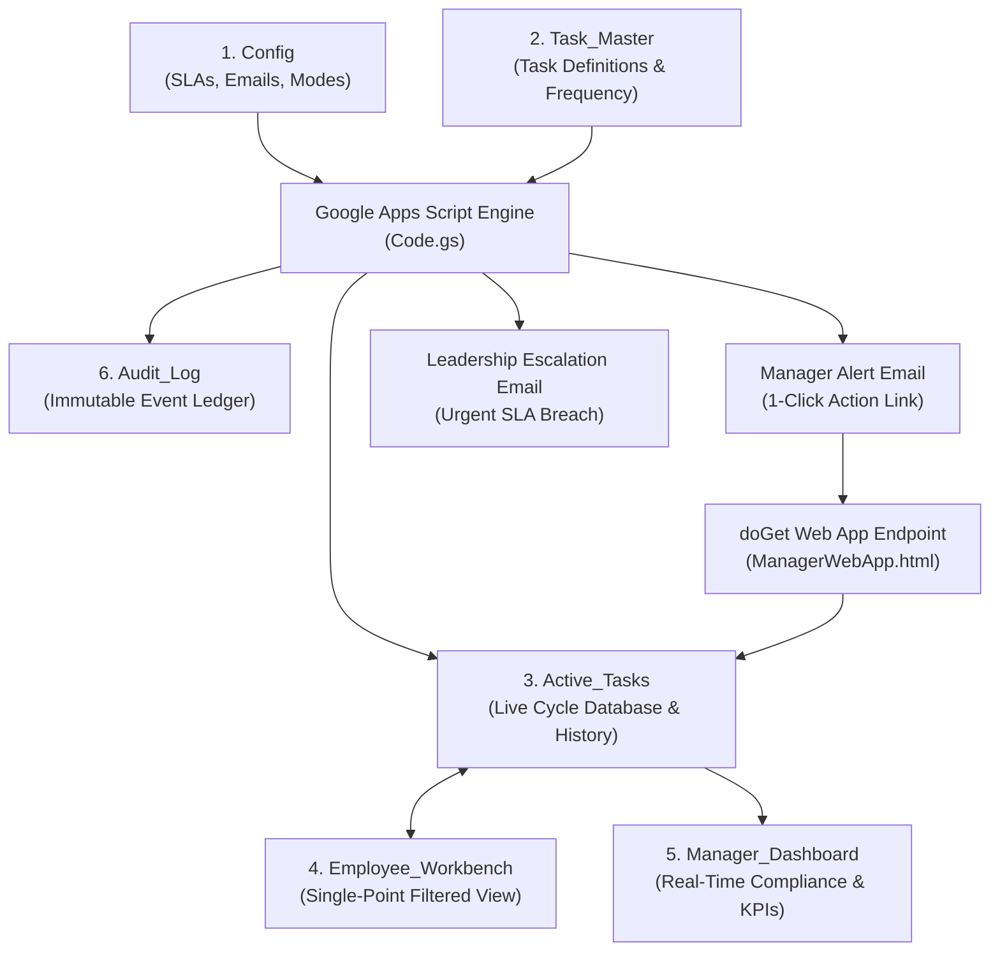
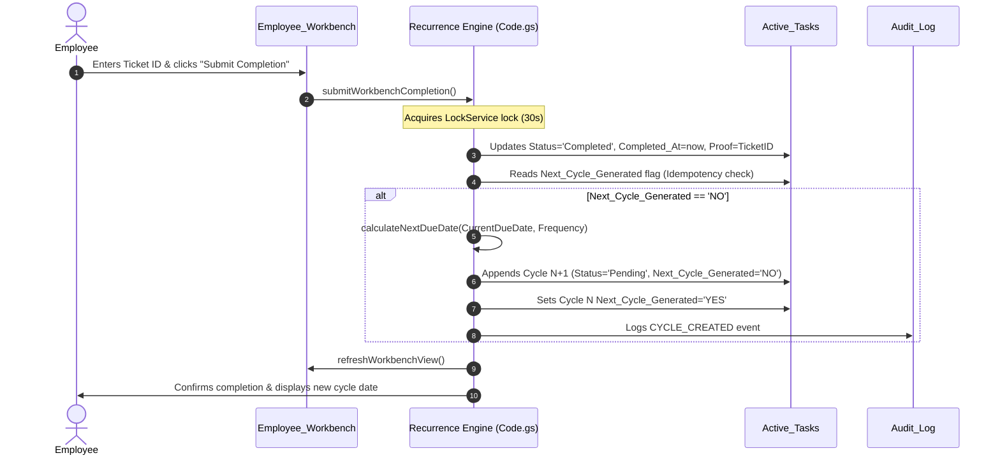

# Allo Innoware: AI Operations Manager System
## Recurring Task Tracking, Pending Reports & Escalation Automation
### System Architecture & Operational Blueprint

---

## 1. Executive Summary & Business Problem

**Allo Innoware** coordinates recurring operational tasks across a lean operations team of 3–4 members (`Employee A`, `Employee B`, `Employee C`, `Employee D`). These tasks recur at diverse cadences:
- **Daily** (Working days, e.g. Operational standups / WhatsApp updates)
- **Every 7 Days** (Weekly operational audits / tickets)
- **Every 15 Days** (Bi-weekly reconciliation / tickets)
- **Every 30 Days** (Monthly audit & compliance closing)

### Core Operational Challenges Addressed:
1. **Manual Cycle Drift**: Employees forgetting when the next cycle is due or manually recalculating future dates.
2. **Duplication of Effort**: Requiring employees to look at one pending sheet, update an external ticket, and then manually record completion across multiple spreadsheet tabs.
3. **Daily Task Verification Gap**: Daily operational actions (such as posting in a WhatsApp group) lack formal ticket IDs, leading to ambiguous completion records.
4. **Delayed Escalation**: Managers discovering overdue tasks days later rather than receiving proactive same-day notifications.
5. **Alert Fatigue & Concurrency Bugs**: Automated scripts sending repeated duplicate emails or generating duplicate recurring cycles.

### The Solution:
A zero-friction, automated operational engine built on Google Sheets and Google Apps Script featuring:
- **Centralized Master Task Catalog** with automated date-advance algorithms.
- **Single-Point Employee Workbench** where employees view tasks and log completion proofs in one place.
- **Structured Daily Proof Protocol** capturing WhatsApp timestamps and summary snippets.
- **Proactive Same-Day Manager Alerts** with a responsive **1-Click Web App Acknowledgement** link.
- **Strict Multi-Tiered SLA Escalation** to leadership for unacknowledged or uncompleted tasks.
- **Concurrency Locks & Idempotent Flags** guaranteeing zero duplicate alerts and zero duplicate cycles.

---

## 2. System Architecture & Data Schema

The system is organized into six interconnected sheets:



### Sheet Definitions & Data Dictionaries

#### 1. `Config` (Operational Parameters)
| Key | Default Value | Description |
| :--- | :--- | :--- |
| `MANAGER_EMAIL` | `manager@innoware.com` | Primary recipient for manager pending alerts |
| `LEADERSHIP_EMAIL` | `leadership@innoware.com` | Recipient for executive escalations |
| `ENABLE_EMAIL_ALERTS` | `TRUE` | Master toggle for email delivery (`FALSE` simulates in Audit Log) |
| `DAILY_TASK_CUTOFF_TIME` | `11:00` | Mandatory deadline for daily operational standups |
| `DAILY_TASK_MANAGER_ALERT_DELAY_MINS` | `30` | Minutes post-cutoff before manager alert triggers (11:30 AM) |
| `DAILY_TASK_LEADERSHIP_ESCALATION_HOURS`| `4` | SLA for manager action before escalating to leadership |
| `PERIODIC_TASK_DUE_TIME` | `17:00` | Standard cutoff time for periodic tasks (7/15/30 days) |
| `PERIODIC_MANAGER_ALERT_DELAY_HOURS` | `16` | Hours post-cutoff before manager alert (09:00 next day) |
| `PERIODIC_LEADERSHIP_ESCALATION_HOURS` | `24` | SLA for periodic resolution before leadership escalation |
| `RECURRENCE_CALCULATION_MODE` | `SCHEDULE_BASED` | `SCHEDULE_BASED` (Prev Due + Freq) or `COMPLETION_BASED` |
| `WEB_APP_URL` | Deployed Script URL | Deployed Apps Script Web App endpoint |
| `TIMEZONE` | `Asia/Kolkata` | Standard operational timezone |

#### 2. `Task_Master` (Catalog of Recurring Tasks)
- `Task_ID`: Unique alphanumeric key (`TSK-001`, `TSK-002`, `TSK-003`, `TSK-004`).
- `Task_Name`: Descriptive operational label.
- `Assigned_To`: Designated team member (`Employee A` to `Employee D`).
- `Employee_Email`: Assigned notification email.
- `Frequency`: Recurrence cadence (`Daily`, `7 Days`, `15 Days`, `30 Days`).
- `Frequency_Days`: Integer days for arithmetic calculation.
- `Expected_Cutoff_Time`: Daily or cycle completion cutoff (e.g. `11:00:00`, `17:00:00`).
- `Proof_Type`: Required verification artifact (`Ticket ID`, `WhatsApp Timestamp & Summary`).
- `Target_Portal_Channel`: System where work occurs (e.g. Jira, ERP, Ops WhatsApp Group).
- `Active`: Boolean flag toggling recurring generation.

#### 3. `Active_Tasks` (Operational State Machine)
This table acts as the state database for both active and historical cycles:
- `Instance_ID`: Cycle-specific identifier (e.g. `TSK-001-C01`, `TSK-001-C02`).
- `Cycle_Number`: Integer cycle sequence.
- `Cycle_Start_Date`: Date when the cycle initialized.
- `Due_Date`: Target completion date.
- `Due_Time`: Target cutoff time.
- `Status`: Current state (`Pending` -> `Manager Alerted` -> `Manager Acknowledged` -> `Escalated` -> `Completed`).
- `Proof_Submitted`: Ticket ID or WhatsApp message snippet provided by employee.
- `Completion_Notes`: Remarks from employee.
- `Completed_By`: Identity/email of completing actor.
- `Completed_At`: ISO timestamp of completion.
- `Manager_Alert_Sent_At`: Timestamp when manager alert email was dispatched.
- `Manager_Acknowledged_At`: Timestamp when manager acknowledged via 1-click or sheet.
- `Manager_Notes`: Follow-up remarks logged by the manager.
- `Leadership_Escalation_Sent_At`: Timestamp when leadership escalation was sent.
- `Next_Cycle_Generated`: Idempotency guard (`YES` / `NO`).

#### 4. `Employee_Workbench` (Single-Point Interface)
- Clean, uncluttered UI designed exclusively for the employee.
- **Dropdown Filter** in `B4` allows selecting `Employee A`, `Employee B`, `Employee C`, `Employee D`, or `All Employees`.
- Shows real-time pending task count.
- Only displays unfinished tasks.
- Columns **H** and **I** are highlighted in light green: the employee types their Ticket ID/Proof directly in Column H, optional notes in Column I, and clicks **Submit Completion** on the custom menu.
- **Zero duplication**: updating this view automatically commits to `Active_Tasks`, spawns the next cycle, and clears the item from the employee's pending view.

#### 5. `Manager_Dashboard` (Monitoring & KPI Summary)
- High-level executive KPI cards:
  - Total Active Cycles
  - Pending Tasks
  - Manager Alerted
  - Manager Acknowledged
  - Escalated to Leadership
  - Completed Cycles
- Team Performance & Compliance table tracking total tasks, overdue counts, and real-time compliance percentage per employee.

#### 6. `Audit_Log` (Immutable Event Ledger)
- Appends timestamped log records for every significant event: `SYSTEM_INIT`, `CYCLE_CREATED`, `COMPLETION_SUBMITTED`, `MANAGER_ALERT_SENT`, `MANAGER_ACKNOWLEDGED`, `LEADERSHIP_ESCALATED`.

---

## 3. Recurring Cycle Logic (Test 1)

### The Business Dilemma: Schedule-Based vs. Completion-Based
When a recurring task repeats every 7 days:
- If a task due on October 1 is completed late on October 3:
  - **Schedule-Based**: Next due date = October 8 (prevents schedule drift).
  - **Completion-Based**: Next due date = October 10 (gives full 7 days from completion).

Our system implements **Schedule-Based** by default to maintain operational discipline, while allowing a 1-click toggle to **Completion-Based** in `Config`.

### Working Day Intelligence for Daily Tasks:
For Daily operational tasks (e.g. `TSK-001`):
- If completed on Friday, the recurrence engine advances the next due date to Monday (skipping Saturday and Sunday), maintaining realistic working day cadences.

### Automated Cycle Generation Flow:


---

## 4. Single-Point Updating & Zero Duplication (Test 2)

### The Problem in Traditional Operations:
Employees frequently abandon tracking spreadsheets because they must:
1. Check Tab A to see what is due.
2. Complete the action in Jira or WhatsApp.
3. Open Tab B to mark a checkbox.
4. Open Tab C to write down the Ticket ID and timestamp.

### The Innoware Single-Point Solution:
1. The employee opens **`Employee_Workbench`**.
2. Selects their name from cell `B4` (or leaves it on their name).
3. The table immediately populates **only their pending items** with clear instructions on what proof is needed.
4. The employee pastes the Ticket ID or WhatsApp update into the editable green Column H (`Enter_Proof_Or_Ticket_ID`).
5. Clicks **`⚡ Allo Innoware Ops > 📝 Employee: Submit Completion (Selected Row)`**.
6. The script handles everything in the background:
   - Validates proof format.
   - Updates the master database (`Active_Tasks`).
   - Generates the next cycle with the calculated due date.
   - Refreshes the workbench so the completed task vanishes from pending.
   - The employee never touches formulas, master sheets, or raw logs.

---

## 5. Daily Task Completion Protocol (Test 3)

### The Challenge: Capturing WhatsApp Updates Without Native Tickets
Daily tasks (such as sharing operational updates in a WhatsApp group) do not naturally produce ticket numbers. 

### Proposed Operational Methodology:
We evaluate three practical implementation models:

| Model | Mechanism | Friction Level | Reliability | Implementation Viability |
| :--- | :--- | :--- | :--- | :--- |
| **Model 1 (Recommended): Timestamp & Summary Snippet** | Employee copies the exact WhatsApp send timestamp and a 1-line snippet into the Workbench. | Very Low (< 15 seconds) | High (Verifiable against group chat) | **Immediate / Zero-cost** |
| **Model 2: Message Link / Screenshot Drive URL** | Employee pastes a WhatsApp Web message link or upload URL of the chat screenshot. | Low | Very High | Immediate |
| **Model 3: WhatsApp Webhook Bot** | A Twilio / WhatsApp Business Cloud API webhook listens for `#OPS_DONE` in group chat and auto-updates the sheet via `doPost()`. | Zero manual work | Highest | Enterprise upgrade path |

### Implementation in Prototype:
Our prototype deploys **Model 1 with Model 2 support**:
- Expected Proof: `WhatsApp Timestamp & Summary` (e.g. `10:45 AM - Ops Standup: 18 dispatches on schedule, zero delays.`).
- The system validates that proof is provided before allowing submission.
- The manager can verify the timestamp against the WhatsApp group in seconds.
- Minimizes administrative overhead while establishing full accountability.

---

## 6. Multi-Tiered Alert & Escalation Engine (Tests 4, 6, 7 & 8)

### Operational Timing & SLA Matrix

```
TASK DUE TIME
     │
     │ (Grace Period: 30 mins for Daily, 16 hrs overnight for Periodic)
     ▼
STAGE 1: SAME-DAY MANAGER ALERT (Test 4)
     │  • Email sent to Manager with 1-Click Acknowledge button
     │  • Status -> "Manager Alerted"
     │  • Manager_Alert_Sent_At stamped
     │
     ├────────────────────────────────────────┐
     ▼                                        ▼
MANAGER ACKNOWLEDGES (Test 5)            MANAGER FAILS TO ACKNOWLEDGE (Test 6)
     │                                        │
     │ • 1-Click link clicked                 │ • SLA Breached (4 hrs Daily / 24 hrs Periodic)
     │ • Status -> "Manager Acknowledged"     │ • Status -> "Escalated"
     │ • Manager_Acknowledged_At stamped      │ • URGENT Email sent to Leadership
     │ • Hold placed on escalation            │ • Leadership_Escalation_Sent_At stamped
     │                                        │
     ▼                                        ▼
TASK COMPLETED BY EMPLOYEE               EXECUTIVE INTERVENTION REQUIRED
     │
     ▼
CYCLE CLOSED & NEXT CYCLE SCHEDULED
```

### SLA Architecture Table:
| Task Category | Due Time / Deadline | Manager Alert Trigger | Manager SLA | Leadership Escalation Trigger |
| :--- | :--- | :--- | :--- | :--- |
| **Daily Operations Update** | 11:00 AM (Working Days) | 11:30 AM (Same Day) | 4 Hours (by 03:30 PM) | 03:30 PM (Same Day) if unacknowledged or uncompleted |
| **7-Day Portal Task** | 05:00 PM on Due Date | 09:00 AM (Next Morning) | 8 Working Hours (by 05:00 PM) | 09:00 AM (Day 2) if unresolved |
| **15-Day Portal Task** | 05:00 PM on Due Date | 09:00 AM (Next Morning) | 24 Hours | 09:00 AM (Day 2) if unresolved |
| **30-Day Portal Task** | 05:00 PM on Due Date | 09:00 AM (Next Morning) | 24 Hours | 05:00 PM (Day 2) if unresolved |

---

## 7. Manager 1-Click Acknowledgement & Web App (Test 5)

When the manager receives the HTML alert email, it includes an action button:
`[Click Here to Acknowledge Task (TSK-xxx-Cxx)]`

### How It Works:
1. The link calls the Google Apps Script Web App: `.../exec?action=ack&id=TSK-001-C01`.
2. The `doGet(e)` function:
   - Validates that the task is still uncompleted.
   - Updates `Status` to `Manager Acknowledged`.
   - Stamps `Manager_Acknowledged_At = new Date()`.
   - Adds note: `Acknowledged via 1-Click Email Action Link`.
   - Appends audit entry to `Audit_Log`.
   - Renders a styled, responsive confirmation page (`ManagerWebApp.html`).
3. **Alternative In-Sheet Option**: If the manager is reviewing the spreadsheet directly, they can select the row on `Manager_Dashboard` or `Active_Tasks` and click **`⚡ Allo Innoware Ops > 👀 Manager: Acknowledge Selected Task`** to enter custom follow-up notes.

---

## 8. Anti-Duplication & Idempotency Architecture (Test 8)

A critical flaw in amateur automation systems is sending repeated alerts every time a timer triggers or generating multiple duplicate cycles when users double-click.

Our system enforces three layers of defense:

1. **Atomic Concurrency Locks (`LockService`)**:
   - `LockService.getScriptLock().waitLock(30000)` ensures that if two users submit simultaneously or if a scheduled trigger fires while a user is submitting, executions are strictly serialized.
2. **Explicit Timestamp Guards**:
   - `Manager_Alert_Sent_At`: Before sending an alert, the engine checks `!managerAlertSentAt`. Once sent, this timestamp is populated, making subsequent scans ignore the row.
   - `Leadership_Escalation_Sent_At`: Before escalating, the engine checks `!leadershipEscalationSentAt`. Once sent, leadership will never receive duplicate spam.
3. **Cycle Generation Idempotency (`Next_Cycle_Generated`)**:
   - The cycle generator checks `Next_Cycle_Generated === 'NO'`. Only after successfully appending the new cycle row does it flip the flag to `'YES'`.

---

## 9. Automated Testing & Verification Framework

The system includes a built-in automated test suite accessible from the Google Sheets custom menu:
- **`runTest1_RecurringCycle()`**: Completes 7-day task, closes cycle, auto-advances due date by 7 days.
- **`runTest2_SinglePointCompletion()`**: Proves employee completion from Workbench without backend editing.
- **`runTest3_DailyTask()`**: Validates WhatsApp proof capture and next-day scheduling.
- **`runTest4_ManagerAlert()`**: Simulates overdue task and triggers same-day manager email with 1-click URL.
- **`runTest5_ManagerAck()`**: Simulates manager acknowledgement and verifies timestamp logging.
- **`runTest6_LeadershipEscalation()`**: Simulates manager SLA breach and fires leadership escalation email.
- **`runTest7_TimingSLA()`**: Prints and validates timing thresholds and SLA logic.
- **`runTest8_AntiDuplication()`**: Executes the escalation engine 3 consecutive times, verifying 0 duplicate emails and 0 duplicate cycles.
- **`runFullTestSuite()`**: Executes all 8 tests end-to-end in sequence.
